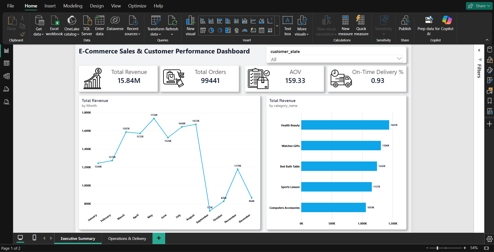
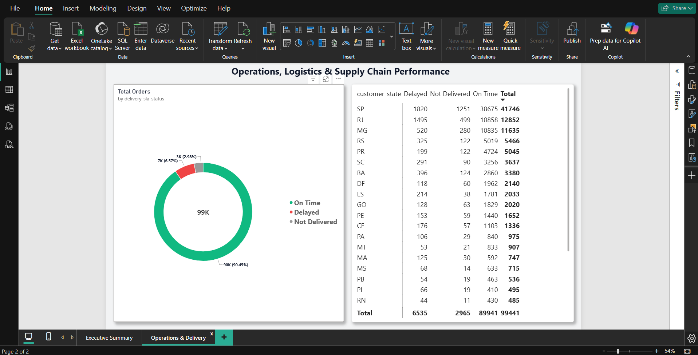

# E-Commerce Sales & Supply Chain Analytics

An end-to-end data analytics project evaluating retail revenue growth, product category profitability, and delivery Service Level Agreement (SLA) performance using **Python**, **SQL Server (T-SQL)**, and **Power BI**.

---

## Executive Summary & Business Problem
High order volume does not automatically translate to sustainable profit when shipping delays, regional logistics bottlenecks, and heavy discounting quietly erode margins and repeat orders. This project builds a unified analytical pipeline across normalized relational tables (`customers`, `orders`, `order_items`, `products`) to give leadership and operations teams visibility into:
* **Revenue & Margin Drivers:** Separating high-grossing product categories from genuinely profitable segments.
* **Supply Chain SLA Compliance:** Pinpointing regional shipping bottlenecks and carrier delays.
* **Time-Series Performance:** Enabling dynamic drill-downs across **Year → Quarter → Month** to track seasonal demand shifts.

---

## Dashboard Preview

### Page 1: Executive Sales & Revenue Overview


### Page 2: Supply Chain & Delivery SLA Operations


---

## Tech Stack & Workflow
* **Python (Pandas, NumPy):** Cleaned raw transactional tables (`customers`, `orders`, `order_items`, `products`), standardized order and delivery timestamps, handled missing records, and engineered delivery SLA and margin fields.
* **SQL Server (T-SQL):** Queried normalized relational tables using Common Table Expressions (CTEs), multi-table joins, `DATEDIFF`, conditional `CASE` logic, and window functions to evaluate regional fulfillment rates and category performance.
* **Power BI (DAX & Data Modeling):** Designed a two-page interactive report featuring custom DAX measures, dynamic slicers, and **Date Hierarchy Drill-Downs (`Year → Quarter → Month`)** for granular trend analysis.

---

## Key Analytical Insights
* **Revenue vs. Net Margin Divergence:** Top-selling product categories generate the bulk of gross sales, but aggressive discounting and return rates compress net margins in specific sub-segments.
* **Regional Fulfillment Bottlenecks:** Delivery delays cluster disproportionately across specific geographic zones and shipping tiers, lowering overall on-time SLA compliance.
* **Logistics Impact on Repeat Orders:** Customers experiencing late deliveries show noticeably lower repeat-purchase frequency compared to on-time orders.
* **Seasonal Demand Spikes:** Time-series drill-downs (`Year → Quarter → Month`) highlight clear seasonal peaks that guide inventory pre-stocking and promotional planning.

---

## Business Recommendations
1. **Optimize Regional Carrier Allocation:** Reassign volume away from underperforming shipping routes and pre-position fast-moving stock in regional fulfillment hubs to improve on-time SLA rates.
2. **Enforce Margin Guardrails on Promotions:** Cap discount thresholds on high-return categories to protect net profitability during seasonal sales peaks.
3. **Proactive Delay Communication:** Trigger automated customer alerts and recovery credits when shipments cross predicted SLA thresholds to protect repeat order retention.

---

## Repository Structure
```text
Ecommerce-Sales-Supply-Chain-Analytics/
├── 02_cleaned_data/
│   ├── clean_customers.csv              # Cleaned customer master table
│   ├── clean_orders.csv                 # Cleaned order & delivery timestamps
│   ├── clean_order_items.csv            # Cleaned line-item sales & pricing
│   └── clean_products.csv               # Cleaned product & category catalog
├── 03_scripts/
│   ├── 01_data_cleaning.ipynb           # Python data cleaning & feature engineering
│   └── ecommerce_queries.sql            # T-SQL queries for revenue & SLA analysis
├── 04_dashboard/
│   └── Ecommerce_Sales_Dashboard.pbix   # Two-page interactive Power BI file
├── Screenshots/
│   ├── page1_sales_overview.png         # Page 1 dashboard preview
│   └── page2_supply_chain.png           # Page 2 dashboard preview
└── README.md                            # Project documentation